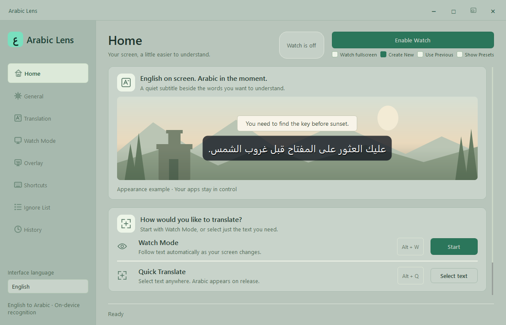
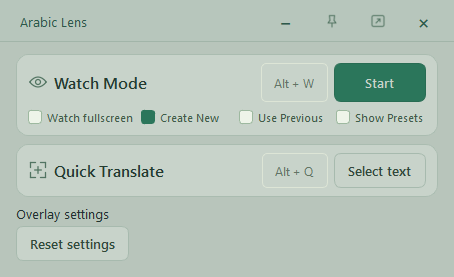

# Arabic Lens

Arabic Lens is a free Windows app that translates English on your screen into Arabic.
It reads the text in any app, game, video or website and shows the Arabic right on top of it.
Everything runs on your own PC: no account, no internet and no API key needed.

## What it does

- **Watch Mode (Alt+W):** follows parts of the screen you choose (or the whole screen) and
  translates text as it appears or changes: subtitles, chat, game menus and so on.
  Translations disappear when the English does.
- **Quick Translate (Alt+Q):** drag a box over any text to translate it once.
- **Overlays you can click through:** the Arabic sits over the English without blocking
  your mouse or game. Size, colours, font and position are adjustable.
- **Offline:** screen reading uses Windows' own text recognition, and translation uses a
  built-in model. Nothing is uploaded unless you choose an online translator in Settings.
- **Keeps itself up to date:** the app checks for new versions and updates quietly with your permission.

A small toolbox gives quick access to both tools without opening the main window:

## Install

1. Download **`ArabicLens-Setup.exe`** from the [latest release](https://github.com/farhanr3001/ocr-translate/releases/latest).
2. Run it, then open **Arabic Lens** from the Start Menu or Desktop.
3. Press **Alt+W** to start watching, or **Alt+Q** to translate a selection.

Requires Windows 10 (version 2004 or newer) or Windows 11, 64-bit, with the English
text-recognition (OCR) language feature installed. Your settings and history are kept
when you update and can be cleared from Settings.

## Good to know

- Machine translation can be literal or wrong with slang, idioms or hard-to-read text.
- Games in exclusive fullscreen may not be capturable; use borderless windowed mode.
- The app only reads the screen like a screenshot does. It does not touch game files or memory.

---

Developers: see the [developer handoff](DEVELOPER_README.md) for architecture, tests and
the build/release workflow. Third-party licences are in [THIRD_PARTY.md](THIRD_PARTY.md).
